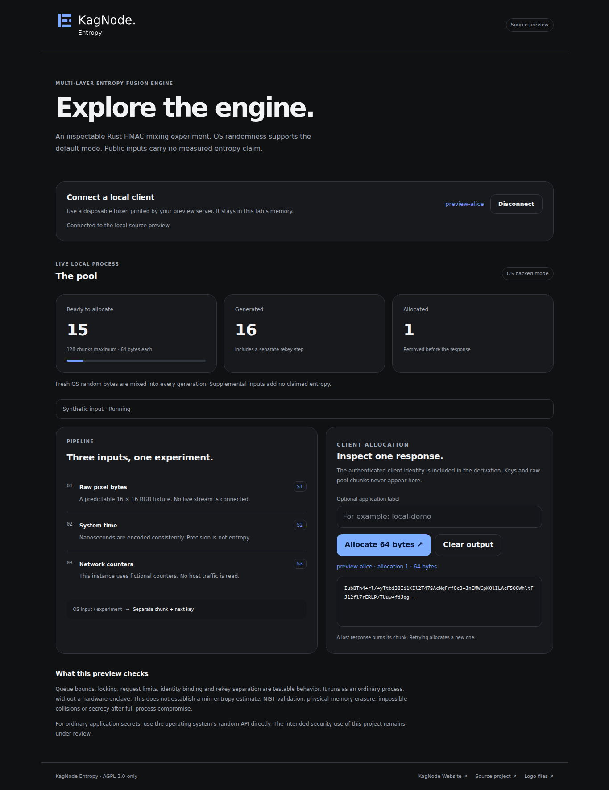
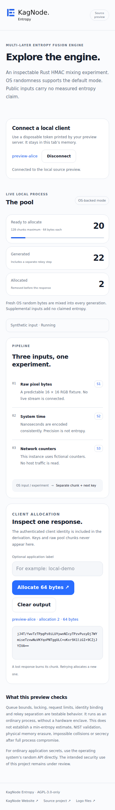

<p align="center"><a href="#brand-artwork"><picture><source media="(prefers-color-scheme: dark)" srcset="static/brand/entropy-lockup-dark.svg"></picture></a></p>
<h1 align="center">KagNode Entropy</h1>
<p align="center">A local Rust service for operating-system cryptographic randomness.</p>

KagNode Entropy distributes bounded, unchanged 64-byte blocks from the OS cryptographic RNG.

## Overview

Screenshots come from the local source preview.

| Desktop                                                                                                                 | Phone                                                           |
| ----------------------------------------------------------------------------------------------------------------------- | --------------------------------------------------------------- |
|  |  |

| Step                   | Detail                                                                                              |
| ---------------------- | --------------------------------------------------------------------------------------------------- |
| Three inputs           | The pipeline takes raw pixel bytes, timestamps and counter bytes.                                   |
| Mixing                 | The three inputs pass through three HMAC-SHA-512 stages.                                            |
| A queue of chunks      | Finished chunks wait in a locked queue and each one is handed out once.                             |
| Bound to the caller    | An authenticated client identity is part of the derivation, and each client has its own rate limit. |
| Two modes              | The default OS-backed mode adds fresh operating-system randomness to every generation.              |
| What it does not claim | No entropy estimate is assigned to video, timing or network input.                                  |

## Release status

**5.0.3** is the coordinated stable source patch, updating shared controls and adding an explicit reviewed local installer. Linux · AGPL-3.0-only.

Stable scope is the OS-backed local service, its API and administration.

## Features

- OS CSPRNG output, bounded atomic batches, per-client quotas and source-failure handling.
- Private persistent client credential hashes, one-time token display, rotation and revocation.
- Separate short-lived administrator sessions, CSRF protection and credential confirmation for access changes.
- Explicit KagNode Account owner linking and fresh sign-in approval; no signup, email matching or remote role assignment.
- Core 5 login, responsive navigation, profile display and account-only appearance controls.
- Optional bounded metadata audit; generated output and credentials are excluded.

## Requirements

Linux; Rust/Cargo 1.88 or newer and the TLS dependencies required by the locked Rust dependencies. Build verification targets Linux x86-64.

## Installation and downloads

| Download                            | Contents                                                               | Platform                                                          |
| ----------------------------------- | ---------------------------------------------------------------------- | ----------------------------------------------------------------- |
| Source `.tar.xz`, `.tar.gz`, `.zip` | Complete allowlisted source, embedded UI and instructions              | Build on supported Linux                                          |
| Source `.deb`                       | Source/documentation under `/usr/share/kagnode/kagnode-entropy-source` | Architecture-independent; no service activation                   |
| Source `.rpm`                       | Same source/documentation                                              | Rocky Linux 10 package-installation scope; no native provisioning |

## Usage

```sh
./target/release/kagnode-entropy init --directory /path/to/new-private-directory
./target/release/kagnode-entropy serve --credentials-file /path/to/new-private-directory/credentials.json
```

## Configuration and storage

The administrator directory is owned by the service user with mode 0700; files use 0600. `credentials.json` contains token hashes and the explicitly linked owner's display profile, not generated randomness or plaintext consumer keys.

## Security

Read [SECURITY.md](SECURITY.md) and the [threat model](docs/THREAT-MODEL.md). The service trusts the OS RNG, host, compiler and dependencies.

## Development and testing

```sh
python3 scripts/build_ui.py
cargo fmt --check
cargo test --locked
cargo clippy --locked --all-targets -- -D warnings
cargo build --locked
python3 tests/browser_check.py
python3 tests/browser_failure_check.py
python3 tests/browser_admin.py
```

## Documentation

|                      |                                        |
| -------------------- | -------------------------------------- |
| Reviewed local setup | [docs/INSTALLER.md](docs/INSTALLER.md) |

## Licensing

Software is **AGPL-3.0-only**; see [LICENSE](LICENSE). Product artwork retains its [separate terms](static/ARTWORK-LICENSE), [pinned provenance](branding.lock.json) and [font notices](static/brand/FONT-NOTICES.txt).
