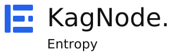

<p align="center"><picture><source media="(prefers-color-scheme: dark)" srcset="static/brand/entropy-lockup-dark.svg"></picture></p>
<h1 align="center">KagNode Entropy</h1>
<p align="center">A Rust source preview for OS-backed randomness and supplemental-input research.</p>

## Overview

KagNode Entropy mixes bounded raw-pixel samples, timestamps and counter bytes through a three-stage HMAC-SHA-512 pipeline. A locked queue allocates each queued chunk once; authenticated client identities bind the final output. Separate HKDF labels derive the next key and queued material.

The default **OS-backed** mode adds fresh operating-system randomness to every generation. **Experimental** mode omits that fresh contribution and requires acknowledgement. Neither mode assigns an entropy estimate to video, timing or network counters. For ordinary application secrets, use the OS RNG directly; this custom composition has not received independent cryptographic review.

## Release status

**0.1.0-alpha.2 · Linux source preview · AGPL-3.0-only**

The runtime is an ordinary Rust process. There is no hosted entropy service, prebuilt binary, published Cargo package or validated enclave target. SGX/Nitro design profiles have simulation-only policy checks, which never authorize secret release. Real video decoding and live-stream compatibility have not been qualified; the connector is tested with mock transport and a fixed-RGB process fixture.

## Features

- Two explicit modes, a 64-byte key, fresh default OS input and independent rekey/output derivation.
- Atomic bounded allocations, authenticated client binding and per-client rate limits and bounded connections.
- Opt-in direct public-video ingestion through a bounded HTTP-to-decoder pipe; synthetic pixels remain the default.
- A locally served responsive KagNode interface, source status and clear failure feedback.
- Optional metadata-only HMAC audit with retention bounds and separate privacy controls.
- Optional own-process tracer policy and best-effort clearing of owned buffers.
- Explicit threat model, source lifecycle tests and SGX/Nitro policy fixtures.

## Requirements

Runtime: Linux. Building requires Rust/Cargo 1.88 or newer and a C build toolchain for the TLS dependency; local checks used Rust 1.99.1 on x86-64 Linux. Other Linux architectures are not qualified by this release.

Video input additionally needs an administrator-installed, maintained FFmpeg executable supporting the documented fixed arguments. The project does not install a decoder or fetch media by default. Development tests use Python 3 for a tiny mock process; browser tests additionally use Playwright.

## Installation and downloads

Only source is released:

```sh
git clone https://github.com/every-lemon/kagnode-entropy.git
cd kagnode-entropy
cargo build --locked --release
```

Use the committed `Cargo.lock`. See [revision history](CHANGELOG.md) for preview changes. There is no installer, auto-updater, daemon registration or infrastructure deployment.

## Usage

```sh
./target/release/kagnode-entropy sample --count 2
./target/release/kagnode-entropy serve
```

Open `http://127.0.0.1:8098`. The terminal prints two disposable client tokens once. Paste one into the interface; it stays in page memory and is cleared on disconnect. Restarting replaces the tokens and engine state. Do not save terminal output containing tokens or redirect generated samples into audit records.

```sh
# Research mode: supplemental entropy is unassessed.
./target/release/kagnode-entropy serve --mode experimental --acknowledge-experimental

# Optional host counters; default counters are fictional.
./target/release/kagnode-entropy serve --linux-counters

# Replace this reserved hostname with an authorized direct public media source.
./target/release/kagnode-entropy serve \
  --video-url 'https://media.example.invalid/live.ts' --video-decoder /usr/bin/ffmpeg
```

The video connector fetches direct HTTP(S) media through checked public addresses, then supplies bytes to a controlled child through stdin. It bounds transfer bytes, raw frames, time, child resources and retries. Watch pages and HLS/DASH playlists are unsupported. See [video configuration](docs/VIDEO.md) before enabling it.

## Configuration and storage

All settings are local CLI arguments. Source URLs, decoder paths and secret tokens cannot be configured through the browser/API. The listener stays on loopback; use `--help` for bounds and options. Engine keys and queue entries are held in memory, subject to the documented limits of buffer clearing.

Auditing is **off by default**. It never records outputs, engine keys, raw media, raw counter blobs, client identities, tokens or context strings. Timing, aggregate counter totals and keyed frame fingerprints are separate privacy opt-ins.

```sh
mkdir -p "$HOME/.local/state/kagnode/entropy"
./target/release/kagnode-entropy audit-key \
  --path "$HOME/.local/state/kagnode/entropy/audit.key"
./target/release/kagnode-entropy serve \
  --audit-key-file "$HOME/.local/state/kagnode/entropy/audit.key" \
  --audit-directory "$HOME/.local/state/kagnode/entropy/audit-session-1" \
  --audit-segment-records 1024 --audit-retained-segments 4
```

Each key/session path must be new. Default retention is four segments of at most 1,024 records each. Graceful shutdown prints a checkpoint to retain independently. Read [audit and defense](docs/HARDENING.md): adjacent logs/checkpoints do not establish independent history, and possession of the audit key allows forgery.

## Security

The construction, real decoder integration and hardware trust assumptions are unqualified. Child resource/protocol limits are not an OS sandbox. Public inputs can repeat or be influenced; diagnostics and hashes are not proofs of entropy. No impossible-collision, zero-vulnerability, root-proof audit or physical-erasure claim is made.

`serve --stop-if-traced` opts into polling this process's `TracerPid`. Polling may miss an attacker or interrupt legitimate debugging. No global host-security settings are modified. SIGKILL and power loss cannot run cleanup handlers. Read [SECURITY.md](SECURITY.md) and the [threat model](docs/THREAT-MODEL.md).

## Development and testing

```sh
cargo fmt --check
cargo test --locked
cargo clippy --locked --all-targets -- -D warnings
cargo build --locked
python3 -m pip install playwright==1.64.1
python3 -m playwright install chromium
python3 tests/browser_check.py
python3 tests/browser_failure_check.py
```

Tests use deterministic samples, fake HTTP, temporary audit fixtures and an isolated RGB-emitting Python stub. They do not fetch a stream or run a real media decoder. See [validation scope](docs/VALIDATION.md). Main is protected by required GitHub Actions checks and a pull-request workflow, including administrators; force-push and deletion are disabled.

## Documentation

[Engine design](docs/DESIGN.md) · [Local API](docs/API.md) · [Video connector](docs/VIDEO.md) · [Audit and defense](docs/HARDENING.md) · [Threat model](docs/THREAT-MODEL.md) · [TEE roadmap](docs/TEE.md) · [Validation](docs/VALIDATION.md)

## Licensing

Source is **AGPL-3.0-only**; see [LICENSE](LICENSE). The product SVGs and transparent favicons come from KagNode Logos, with [pinned provenance](branding.lock.json), [artwork terms](static/ARTWORK-LICENSE) and retained [outlined typography notices](static/brand/FONT-NOTICES.txt). The locally bundled Core stylesheet has [provenance](static/core/NOTICE) and a [pinned digest](core.lock.json). The interface uses system fonts.

[KagNode Website](https://nebulacoder.com) · [Developer](https://developer.nebulacoder.com) · [Source](https://github.com/every-lemon/kagnode-entropy)
